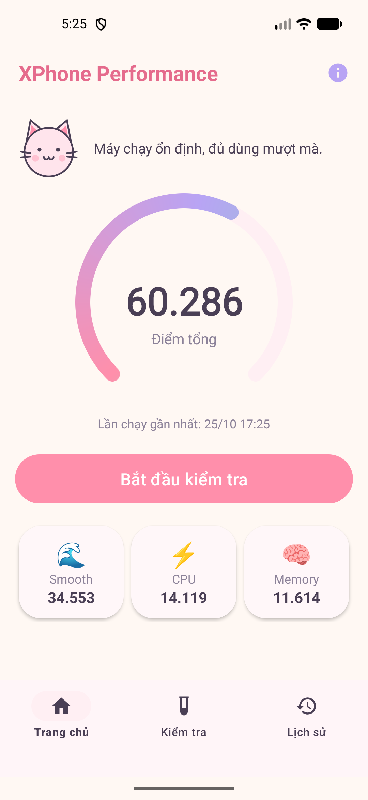
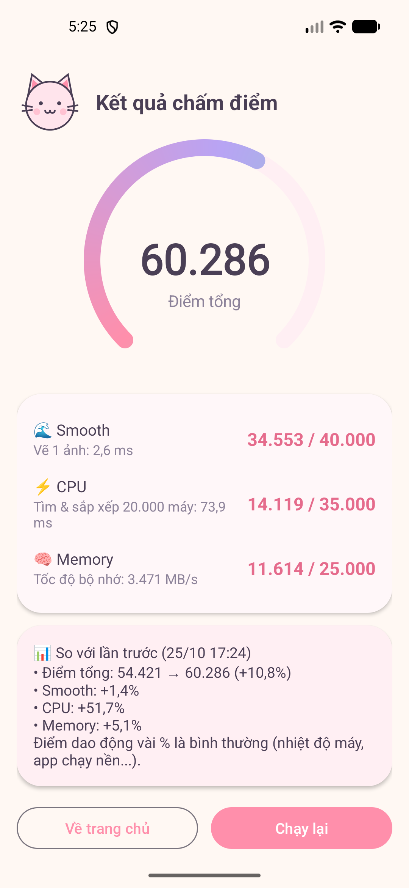
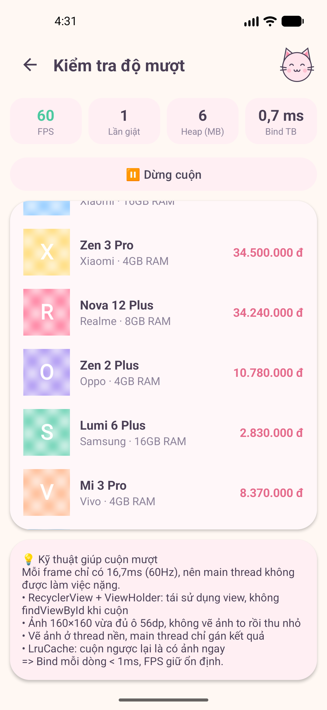
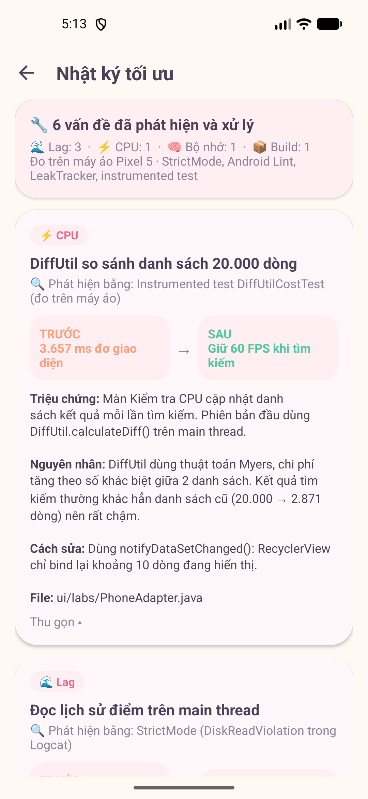

# XPhone Performance

Ứng dụng Android chấm điểm hiệu năng điện thoại (lấy cảm hứng bố cục từ AnTuTu Benchmark), đồng thời là một dự án thực hành **phân tích – phát hiện – tối ưu hiệu năng** cho chính ứng dụng: giật lag, mức dùng CPU và rò rỉ bộ nhớ.

> Đề tài: *Android Application Performance Analysis and Optimization (Performance Profiling)*
> Môn: Phát triển ứng dụng di động

<p align="center">
  
  
  
  
</p>

---

## Mục lục

- [Tính năng](#tính-năng)
- [Ba trọng tâm hiệu năng](#ba-trọng-tâm-hiệu-năng)
- [Nhật ký tối ưu](#nhật-ký-tối-ưu)
- [Công cụ phân tích được tích hợp](#công-cụ-phân-tích-được-tích-hợp)
- [Cách chấm điểm](#cách-chấm-điểm)
- [Cấu trúc mã nguồn](#cấu-trúc-mã-nguồn)
- [Cài đặt và chạy](#cài-đặt-và-chạy)
- [Kiểm thử](#kiểm-thử)

---

## Tính năng

| Màn hình | Mô tả |
|---|---|
| **Trang chủ** | Vòng điểm tổng, 3 thẻ điểm thành phần (Smooth / CPU / Memory), linh vật "Mèo XPhone" đổi biểu cảm theo điểm |
| **Chấm điểm** | Chạy 3 bài benchmark trên thread nền, hiện kết quả và so sánh % với lần đo trước |
| **Kiểm tra trực tiếp** | 3 màn đo theo thời gian thực với thanh chỉ số **FPS · % CPU · số lần giật · Heap · chỉ số riêng** |
| **Nhật ký tối ưu** | Các vấn đề hiệu năng thật đã phát hiện khi phát triển, kèm công cụ phát hiện và số đo trước / sau |
| **Lịch sử** | Biểu đồ cột 8 lần đo gần nhất, đánh dấu lần đo kỷ lục |
| **Thông tin máy** | Hãng, Android, số nhân CPU, RAM, heap tối đa, độ phân giải, tần số quét, thời gian 1 frame |

Giao diện dùng bảng màu pastel "Strawberry Milk", Material 3, icon và linh vật tự vẽ bằng Canvas / vector.

---

## Ba trọng tâm hiệu năng

### 🌊 Lag / Jank — Kiểm tra độ mượt

Danh sách 300 điện thoại có ảnh, có chế độ tự động cuộn để đo FPS ổn định.

| Kỹ thuật | Lý do |
|---|---|
| `RecyclerView` + `ViewHolder` | Tái sử dụng view, không `findViewById` khi cuộn |
| Ảnh đúng kích thước hiển thị (160×160) | Ảnh 900×900 tốn ~30 lần CPU và ~3,2 MB RAM mỗi ảnh |
| Vẽ ảnh trên `ExecutorService` | Main thread chỉ gán Bitmap, mỗi frame giữ dưới 16,7 ms |
| `LruCache` giới hạn 1/8 heap | Cuộn ngược là có ảnh ngay, không gây OutOfMemory |
| Gắn tag id vào `ImageView` | Tránh hiện nhầm ảnh khi view bị tái sử dụng |

Kết quả đo trên máy ảo Pixel 5: **60 FPS**, bind trung bình **0,7 ms/dòng**.

### ⚡ CPU — Kiểm tra CPU

Tìm kiếm trực tiếp trong cửa hàng 20.000 điện thoại.

| Kỹ thuật | Lý do |
|---|---|
| Chỉ mục dựng sẵn 1 lần (chuỗi viết thường + `HashMap` đếm tầm giá) | Không tạo chuỗi rác mỗi lần gõ phím |
| `Collections.sort` (TimSort) — O(n log n) | Thay cho thuật toán sắp xếp O(n²) |
| Debounce 300 ms | Gõ liên tục chỉ tìm 1 lần khi ngừng gõ |
| Tìm kiếm trên thread nền + `searchGeneration` | Main thread luôn rảnh; bỏ kết quả cũ về muộn |

Kết quả: **~5–10 ms/lần tìm**, app dùng **~1% CPU**, giữ 60 FPS khi gõ.

### 🧠 Memory Leak — Kiểm tra rò rỉ bộ nhớ

Mở/đóng liên tục màn hình giữ 8 MB dữ liệu, sau đó chạy GC và đếm số màn hình còn sống bằng `WeakReference`.

| Kỹ thuật | Lý do |
|---|---|
| Không lưu Activity vào biến static / Singleton | Static sống suốt app, giữ Activity thì GC không thu hồi được |
| `SafeRunnable` (lớp tĩnh + `WeakReference`) | `new Runnable(){}` ẩn danh ngầm giữ Activity |
| `removeCallbacksAndMessages`, `shutdownNow` trong `onDestroy` | Hủy hẹn giờ và thread nền còn chờ |
| `HistoryStore` chỉ giữ `applicationContext` | Không giữ Activity |

Kết quả: **0 màn hình bị giữ lại** qua nhiều lần thử, LeakCanary không báo leak.

---

## Nhật ký tối ưu

Các vấn đề **thật** phát hiện trong quá trình phát triển (đo trên máy ảo Pixel 5, 25/10/2026). Xem chi tiết trong app: tab **Kiểm tra → Nhật ký tối ưu**, hoặc file [`OptimizationLog.java`](app/src/main/java/com/xphone/performance/data/OptimizationLog.java).

| Nhóm | Vấn đề | Phát hiện bằng | Trước | Sau |
|---|---|---|---|---|
| ⚡ CPU | `DiffUtil` so sánh 20.000 dòng trên main thread | Instrumented test `DiffUtilCostTest` | 3.657 ms đơ giao diện | Giữ 60 FPS |
| 🌊 Lag | Đọc `SharedPreferences` trên main thread | StrictMode (`DiskReadViolation`) | Chặn 54 ms (≈ 3 frame) | 0 vi phạm |
| 🌊 Lag | Vẽ nền 2 lần (overdraw) ở 6 màn hình | Android Lint | 6 cảnh báo | 0 |
| 🌊 Lag | Layout lồng thừa, căn baseline thừa | Android Lint | 3 cảnh báo | 0 |
| 🧠 Bộ nhớ | Báo nhầm 1 màn còn sống do đếm trước `onDestroy` | LeakTracker + kiểm tra lại | Báo sai 1 màn | 0 qua 3 lần thử |
| 📦 Build | Bản release chưa bật R8 | Benchmark + kích thước APK | Debug: 7,6 MB · 52.696 điểm | Release: 1,5 MB · 72.280 điểm |

---

## Công cụ phân tích được tích hợp

| Công cụ | Vai trò | Vị trí |
|---|---|---|
| **StrictMode** | Báo đọc/ghi đĩa, mạng trên main thread; Activity bị leak (bản debug) | [`XPhoneApp.java`](app/src/main/java/com/xphone/performance/XPhoneApp.java) |
| **LeakCanary** | Tự phát hiện memory leak, hiện thông báo kèm leak trace (bản debug) | `app/build.gradle.kts` |
| **FrameMonitor** | Đo FPS và số frame giật qua `Choreographer` | [`monitor/FrameMonitor.java`](app/src/main/java/com/xphone/performance/monitor/FrameMonitor.java) |
| **CpuUsageMonitor** | % CPU của tiến trình qua `Process.getElapsedCpuTime()` | [`monitor/CpuUsageMonitor.java`](app/src/main/java/com/xphone/performance/monitor/CpuUsageMonitor.java) |
| **LeakTracker** | Đếm đối tượng còn sống bằng `WeakReference` | [`core/leak/LeakTracker.java`](app/src/main/java/com/xphone/performance/core/leak/LeakTracker.java) |
| **`<profileable>`** | Cho phép Android Studio Profiler gắn vào bản release | `AndroidManifest.xml` |
| **R8** | Thu gọn và tối ưu bytecode bản release | `app/build.gradle.kts` |

Kiểm chứng thêm bằng Android Studio: **Profiler** (CPU System Trace / Method Trace, Memory Heap Dump), **Layout Inspector**, Developer options → **Profile GPU Rendering**.

---

## Cách chấm điểm

```
Thời gian (Smooth, CPU):  điểm = TỐI_ĐA × MỐC / (MỐC + thời_gian)
Tốc độ   (Memory):        điểm = TỐI_ĐA × tốc_độ / (tốc_độ + MỐC)
```

| Bài | Khối lượng công việc | Mốc (= một nửa điểm) | Tối đa |
|---|---|---|---|
| 🌊 Smooth | Vẽ 60 ảnh thumbnail, không cache | 16,67 ms/ảnh (1 frame ở 60 Hz) | 40.000 |
| ⚡ CPU | Dựng chỉ mục + 5 truy vấn trên 20.000 máy | 50 ms | 35.000 |
| 🧠 Memory | Ghi + copy + đọc khối 8 MB × 24 vòng | 4.000 MB/s | 25.000 |
| **Tổng** | | | **100.000** |

---

## Cấu trúc mã nguồn

```
app/src/main/java/com/xphone/performance/
├── XPhoneApp.java              # Application: bật StrictMode ở bản debug
├── benchmark/                  # 3 bài đo + bộ chạy + công thức chấm điểm
│   ├── SmoothBenchmark.java
│   ├── CpuBenchmark.java
│   ├── MemoryBenchmark.java
│   ├── BenchmarkRunner.java    # chạy tuần tự trên thread nền, báo tiến độ về main
│   └── ScoreCalculator.java
├── core/
│   ├── image/                  # ImageLoader (thread nền + LruCache), ThumbnailPainter
│   ├── search/                 # PhoneSearch (chỉ mục + TimSort + HashMap)
│   └── leak/                   # LeakTracker, SafeRunnable
├── monitor/                    # FrameMonitor, CpuUsageMonitor, MemoryMonitor, BindStats
├── data/                       # FakePhoneRepository, HistoryStore (I/O nền), OptimizationLog
├── ui/
│   ├── main/                   # MainActivity + Bottom Navigation
│   ├── home/  benchmark/  history/  device/  log/
│   ├── labs/                   # BaseLabActivity + 3 màn kiểm tra (lag / cpu / memory)
│   └── widget/                 # ScoreRingView, MascotView, BarChartView (tự vẽ)
└── util/                       # FormatUtils, UiUtils
```

---

## Cài đặt và chạy

**Yêu cầu:** Android Studio (bản mới), JDK 17+, Android SDK 37. Thiết bị / máy ảo Android 7.0 (API 24) trở lên.

```bash
git clone <địa-chỉ-repo>
```

1. Mở thư mục dự án bằng Android Studio, chờ Gradle Sync.
2. Chọn thiết bị và bấm **Run** (bản debug — có StrictMode và LeakCanary).
3. Để đo số liệu sát thực tế, dùng bản release (đã bật R8, ký bằng debug key):

```bash
./gradlew installRelease
```

---

## Kiểm thử

```bash
./gradlew testDebugUnitTest            # unit test: kết quả tìm kiếm đúng, công thức điểm đúng
./gradlew connectedDebugAndroidTest    # đo DiffUtil trên thiết bị (Logcat tag "DiffCost")
./gradlew lintDebug                    # báo cáo Lint: app/build/reports/lint-results-debug.html
```

- `PhoneSearchTest` — đối chiếu `PhoneSearch` (đã tối ưu) với một cách tính đơn giản, đảm bảo tối ưu không làm sai kết quả.
- `DiffUtilCostTest` — đo chi phí `DiffUtil` với 20.000 dòng, nguồn số liệu cho Nhật ký tối ưu.
